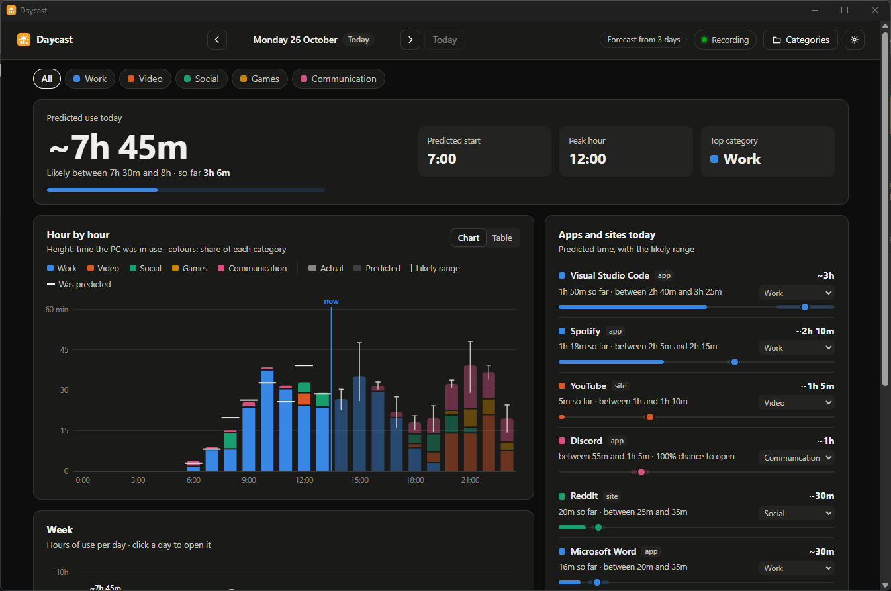

**English** · [Italiano](README.it.md)


# Daycast

The weather forecast for your PC time: Daycast predicts how much you will use
your PC today, hour by hour, and which apps and sites (YouTube, Reddit, …)
you will open, with an uncertainty range.

**[Download the latest version](https://github.com/Fede046/Daycast/releases/latest)** · Windows 10/11 · free and open source



> Current status: the **logger** records apps and sites, the **interface**
> shows the real data and the forecast uses Mistral AI's
> [Timestral](https://mistral.ai/news/timestral/) whenever it is more accurate
> than the baseline forecast.
>
> The interface is in English and Italian (choose in Settings).
> Daycast was called TimeScreen up to version 0.4.

## Installation (app)

1. Download `Daycast-<version>-win64.zip` from the
   [Releases](https://github.com/Fede046/Daycast/releases) page and extract
   it wherever you like (for example in `Documents`).
2. Open `Daycast\Daycast.exe`.

On first launch, recording starts in the background (icon next to the clock)
and the window with your data opens. Closing the window keeps recording; to
stop it: icon → **Quit**.

In the window, the dot at the top shows the recording status (active, paused,
off). Click it, or the gear, to open **Settings**:

- **Language**: English or Italian, applied right away.
- **Recording**: pause, resume, or start it if it is off.
- **Start Daycast with Windows**: recording starts on its own at every
  sign-in. Once on, Daycast also shows up in Windows Settings → Apps →
  Startup and in Task Manager → Startup apps; if you turn it off there,
  Daycast's switch follows.
- **Data folder**: opens `%LOCALAPPDATA%\Daycast`.

The same options (pause, start with Windows) are in the icon's menu.

Python is not required. You need Windows 10/11 with WebView2 (already included
in Windows 11). The zip is about 185 MB because it contains PyTorch and the
Timestral model for the forecasts; everything works offline. Windows may show
a SmartScreen warning because the exe is not signed: *More info* → *Run anyway*.

Your data stays in `%LOCALAPPDATA%\Daycast`; to uninstall, quit from the
icon, turn off "Start with Windows" and delete the folder. Coming from
TimeScreen? Quit it from its icon first: on its first launch Daycast moves
your data from `%LOCALAPPDATA%\TimeScreen`. If you had start with Windows on,
turn it off and on again in Settings to replace the old TimeScreen entry.

## Running from source

Requires Python 3.10+ on Windows.

```bash
python -m venv .venv
.venv\Scripts\pip install -r requirements.txt
.venv\Scripts\pip install -r requirements-forecast.txt   # optional: Timestral (PyTorch, ~600 MB)
.venv\Scripts\python -m daycast
```

Without `requirements-forecast.txt` everything works, with the baseline
forecast only. With Timestral installed, the model (21 MB) is downloaded once,
on first use, into `daycast/models/`.

Same as the exe: it starts the logger if it is not already running and opens
the window (pywebview, using Windows' WebView2). `python -m daycast ui`
opens only the window. To work on the UI in a browser:

```bash
python -m daycast --browser
```

The interface uses the logger's data as soon as there is any; until then it
shows sample data. With `--demo` it always shows the sample data.

## Forecast

There are two models, and Daycast shows the one that is more accurate on
your data.

- **Baseline forecast**: for each hour, the average of the same weekdays
  recorded so far (with fewer than 3, it uses weekdays or weekend days, then
  all days); the range goes from the 10th to the 90th percentile of those
  days. It starts after the first full day of data.
- Mistral AI's **[Timestral](https://mistral.ai/news/timestral/)-5M**, a
  time-series model: it predicts PC usage hour by hour and every app or site
  used for at least 10 minutes, plus each day's total, with a 10th–90th
  percentile range. It kicks in after 7 days of data.

Once a day, when you open the window, a separate low-priority process
(`daycast forecast`) loads Timestral, predicts today and the rest of the
week, and re-runs the forecasts for the last 7 days to compare them with the
baseline. If Timestral's average error was lower (with at least 3 days to
compare), the window shows its forecasts, otherwise the baseline ones; the
label at the top says which and why. The run takes a few seconds and then the
process exits: neither the logger nor the window loads PyTorch.

Either way, each day is predicted only from the days before it, so "was
predicted" is a fair comparison.

## Logger

Records in the background which app or site you are using. It is lightweight:
about 20 MB of RAM from source (about 50 MB in the exe) and practically zero CPU.

It runs as a background app with an icon in the notification area, next to the
clock (if you can't see it, it is among the hidden icons under the ^ arrow).
Click the icon for the menu: **Open Daycast**, **Pause** / **Resume**,
**Start with Windows**, **Quit**. Double-click opens Daycast. While paused the icon turns grey.

```bash
python -m daycast log        # start the logger with the icon (--console to stay in the terminal)
python -m daycast report     # today's summary (--date YYYY-MM-DD for another day)
python -m daycast autostart  # start it at every Windows sign-in, without a console (--off to remove)
```

- Every 2 seconds it checks the foreground window; it writes to disk only when
  something changes, plus an update every 30 seconds.
- **Sites**: in browsers (Chrome, Edge, Firefox, Brave, Opera, Vivaldi…) it
  reads the active tab's address from the address bar (Windows UI Automation)
  and keeps the domain: every site gets its own entry (`ansa.it`,
  `unibo.it`…), with subdomains grouped together (`virtuale.unibo.it` →
  `unibo.it`). Well-known sites get a friendly name (YouTube, Gmail, Reddit…).
  The address bar is read again only when the tab changes; if it can't be
  read, the window title is used. Names and rules are in `daycast/sites.py`.
- **Privacy**: only the app name or the site's domain and the times are saved,
  never full addresses or window titles. Everything stays in
  `%LOCALAPPDATA%\Daycast\usage.db`.
- **Idle time**: after 2 minutes without keyboard and mouse it stops counting,
  unless something keeps the screen on (a video, a film). Sleep and switches
  shorter than 3 seconds are not counted.

## Reading the charts

Several apps can be in use in the same hour (music while you work, Discord
while you play). With the **All** filter, the height of each bar is the
time you used the PC, so never more than 60 minutes in an hour, and each
category takes a share proportional to its use. The tooltip shows each
category's actual minutes and its percentage.

## Categories

You decide the categories, from the **Categories** button: you can create them
(up to 8, as many as there are distinguishable colours), rename them, delete
them and assign each app or site. Until you assign them, apps stay
*Unclassified*. Your choices are saved in
`%LOCALAPPDATA%\Daycast\settings.json` (for testing you can point to another
file with the `DAYCAST_SETTINGS` variable).

## Project structure

| Path | What it does |
|---|---|
| `daycast/cli.py` | commands: `start`, `ui`, `log`, `report`, `autostart`, `forecast` |
| `daycast/app.py` | pywebview window, or local server with `--browser` |
| `daycast/logger.py` | logger loop: foreground window, idle time, sleep |
| `daycast/tray.py` | notification-area icon with the logger's menu |
| `daycast/launcher.py` | relaunches Daycast (from source or the exe) and checks whether the logger is running |
| `daycast/control.py` | pause, resume and status of the running logger, for the UI |
| `daycast/winapi.py` | Win32 calls via ctypes |
| `daycast/paths.py` | data folder, and moving it over from TimeScreen |
| `daycast/sites.py` | from domain (or title) to site name |
| `daycast/browser_url.py` | reads the address bar with UI Automation |
| `daycast/db.py` | SQLite database and minutes per hour |
| `daycast/settings.py` | user categories and app assignments |
| `daycast/real_data.py` | dashboard from the logger's data: baseline or Timestral forecast |
| `daycast/forecast.py` | Timestral forecasting process and comparison with the baseline |
| `daycast/mock_data.py` | sample data; its output format is the contract with the UI |
| `daycast/ui/` | HTML/CSS/JS interface, no external libraries; translations in `i18n.js` |
| `daycast/assets/` | logo icons (regenerate with `python tools/make_icons.py`) |
| `packaging/` | PyInstaller spec and build script |
| `tests/` | unit tests |
| `THIRD_PARTY_NOTICES.md` | licenses of the Timestral model and the bundled libraries |

## Tests

```bash
.venv\Scripts\python -m unittest discover -s tests -t .
```

With `requirements-forecast.txt` installed the Timestral test runs too;
without it, it is skipped.

## Building the exe and the zip

```bash
.venv\Scripts\pip install -r requirements-dev.txt
.venv\Scripts\python packaging\build.py
```

This creates `dist\Daycast\Daycast.exe` and
`dist\Daycast-<version>-win64.zip` (PyInstaller, a folder rather than a
single exe: it starts faster and antivirus software complains less). The
version is in `daycast/__init__.py`. The build downloads the Timestral-5M
model if it is missing and bundles it, together with `THIRD_PARTY_NOTICES.md`
with the model and library licenses.

## Roadmap

Done:

- Interface with hour-by-hour and weekly charts, user-defined categories and settings
- Lightweight background logger with a tray icon, recognising every website by its domain
- Baseline forecast and Timestral forecast, chosen automatically by comparing them on your data
- Downloadable app (zip with `Daycast.exe`)
- Interface in English and Italian

Ideas for later:

- More languages: add them to `daycast/ui/i18n.js`
- Count apps playing audio in the background (music while you work)
- Signed exe or installer, so SmartScreen stops warning
- Lighter download, running Timestral with ONNX Runtime instead of PyTorch

## License

Daycast is released under the [MIT License](LICENSE). The bundled
Timestral-5M model weights are © 2026 Mistral AI, under a Modified MIT license:
see [THIRD_PARTY_NOTICES.md](THIRD_PARTY_NOTICES.md).
